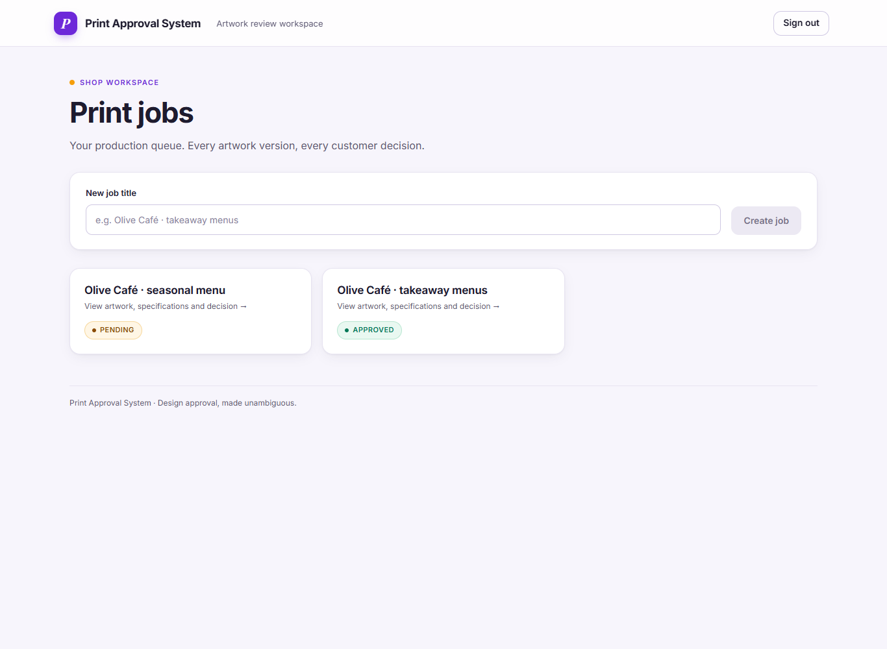
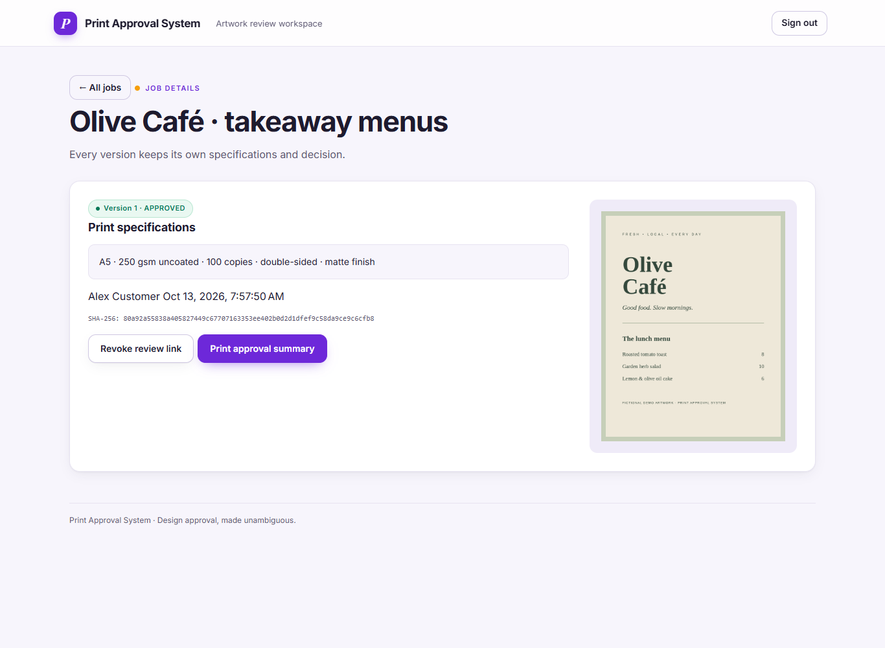
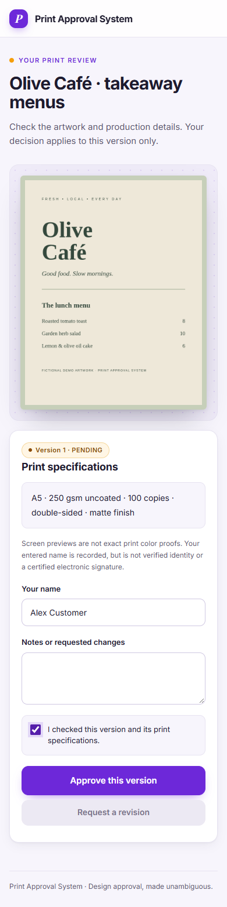
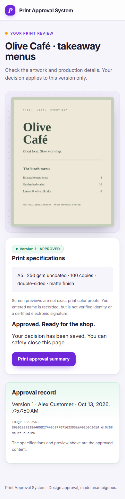
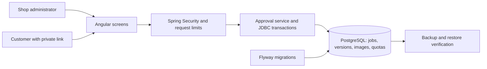

# Print Approval System

[](https://github.com/Javanian/Print-Approval-System/actions/workflows/ci.yml)

A small print shop needs a clear yes or no from the customer on one specific preview and its print specifications before anything goes to production. This app gives the shop a work list and gives the customer a private mobile link where they approve or request changes, without creating an account.

| Shop work list | Approved version and specifications |
| --- | --- |
|  |  |

 

Screenshots come from the running production container with fictional café data.

## How it works

1. The shop administrator signs in and creates a job.
2. They upload a JPG or PNG preview with size, paper stock, quantity, sides and finish.
3. They create a private review link and send it through whatever channel they already use with the customer.
4. The customer opens the link on their phone, checks the preview and specifications, enters their name, then approves or asks for a revision.
5. The shop prints the approved record. An approved job is locked; further work needs a new job.

Rules the system enforces:

- Every version stays in the shop's history. Uploading a new version blocks approval of an older pending one.
- Replacing a link invalidates the old link. Revoking a link blocks both viewing and submitting.
- Submitting the same decision twice returns the original result and timestamp instead of creating a duplicate.

### Lifecycle of a proof version

<picture>
  <source media="(prefers-color-scheme: dark)" srcset="https://raw.githubusercontent.com/Javanian/Print-Approval-System/main/docs/diagrams/print-version-lifecycle-dark.svg">
  
</picture>

Each state and transition is traced to the code it comes from in [docs/diagrams/print-version-lifecycle.json](docs/diagrams/print-version-lifecycle.json).

## Architecture

| Layer | Choice | Why |
| --- | --- | --- |
| Frontend | Angular 21, TypeScript 5.9 | Strict templates for a compact, responsive three-screen workflow |
| Backend | Java 21, Spring Boot 4.1.1 | One deployable service with authentication, validation and transaction boundaries |
| Persistence | PostgreSQL 17.11, JDBC, Flyway | Explicit row locks, version history and reproducible migrations |
| Preview storage | Normalized PNGs inside PostgreSQL | Authorization on every read and a single backup |
| Verification | JUnit with real PostgreSQL, Playwright, axe-core | State rules, browser journeys and accessibility checks |
| Packaging | Docker Compose, GitHub Actions | Reproducible startup and verification on every commit |



Trade-offs I accepted: storing images in the database simplifies privacy and backups but grows the database; one shop account keeps setup small but rules out multi-tenant use; in-process throttling avoids an extra service but needs edge rate limiting if more than one instance runs. The reasoning is recorded as ADRs in [docs/architecture.md](docs/architecture.md).

## Safeguards

- Throttling on login and on public review links.
- Upload size limits, image normalization and image-storage quotas checked inside the same transaction. A quota failure keeps the previous proof intact.
- Fixed error responses and sanitized error logs.
- Backup and restore scripts that restore into a fresh database and verify images and storage accounting.

These do not replace TLS, real secrets management, edge controls or monitoring in a public deployment. See the [runbook](docs/runbook.md).

## Run locally with Docker

Requirements: Docker Engine with Compose v2.

```sh
cp .env.example .env
# Replace both password placeholders. The administrator password needs at least 16 characters.
docker compose up --build -d
```

Open http://localhost:8080 and sign in with the administrator password (the username is fixed to `admin`). The port is bound to loopback and cookies are sent over plain HTTP, so do not expose this configuration to the internet.

The app starts empty, with no seeded accounts or jobs. Follow the [five-minute demo](docs/demo.md) to create sample content.

## Tests

Requirements: JDK 21, Maven 3.9.11, Node 24.19.0, PostgreSQL 17.11. Use a separate, disposable database.

```sh
export DB_URL=jdbc:postgresql://localhost:55432/print-approval-system
export DB_PASSWORD=your-local-db-password
export ADMIN_PASSWORD=your-local-admin-password-at-least-16-chars
export COOKIE_SECURE=false

mvn -f backend/pom.xml verify                       # backend tests on real PostgreSQL
java -jar backend/target/print-approval-system-1.0.0.jar

cd frontend && npm ci && npm run build && npx tsc --noEmit
npm start                                           # second terminal
npx playwright install chromium && npm test         # third terminal
```

- The Spring suite covers lifecycle rules, concurrency, idempotent decisions, stale, revoked and rotated links, authorization, CSRF and upload validation.
- Playwright drives the real Angular UI: mobile approval, printable results, revisions, invalid credentials and files, and network recovery.
- Browser tests use `BASE_URL` (default http://localhost:4200) and create their own jobs. Never point them at production.

Test output is kept in [docs/evidence](docs/evidence/) and summarized in [docs/qa.md](docs/qa.md).

## Scope

Not included on purpose: a design editor, PDF or CDR rendering, payments, invoicing, messaging integrations, scheduling, analytics and multi-shop tenancy.

A customer-entered name is not a verified identity or a certified electronic signature, and on-screen colors are not a color-accurate print proof.

This is a portfolio project. The product idea, that small print shops would pay for an explicit approval record, has not been tested with real customers. The next question to answer is whether a shop owner and customer can complete a real approval without help, and whether the record reduces disputed reprints.

## Documentation

[Architecture and ADRs](docs/architecture.md) · [API](docs/api.md) · [Runbook](docs/runbook.md) · [QA evidence](docs/qa.md) · [Demo script](docs/demo.md) · [Design system](docs/design-system.md)

## Author

Tee San ([Javanian](https://github.com/Javanian)) · [Portfolio](https://porto.hillteo.com) · [teesanfajar@gmail.com](mailto:teesanfajar@gmail.com)
